<!--
  Pixel-art profile README.

  Every image is generated by tools/build.mjs (plain Node 18+, no packages):
    1. edit the content block at the top of tools/build.mjs
    2. run `node tools/build.mjs`
    3. commit the changed files in assets/

  The two live panels (achievements, activity) are rebuilt every day from the
  GitHub and LeetCode APIs by .github/workflows/pixel-panels.yml and served
  from the `output` branch, so their numbers are never hand-typed.
-->

  

  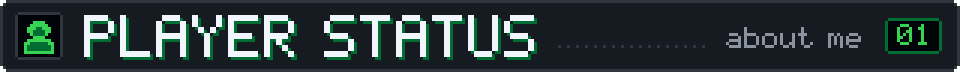 
  

> **▶ HIMANSHU:** Deep learning with TensorFlow / Keras, algorithms in C++, and fixes for the open-source tools I use every day.

  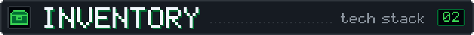 
  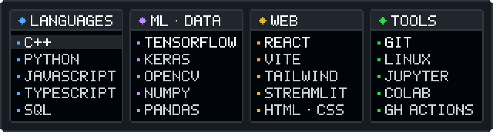

  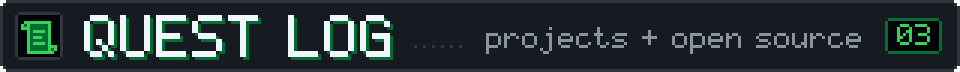 
  <a href="https://github.com/cline/cline/pull/15406">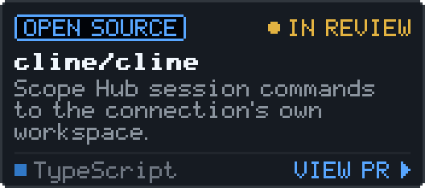</a>
  <a href="https://github.com/learning-unlimited/learning-unlimited.github.io/issues?q=author%3Atransmogrify-cell">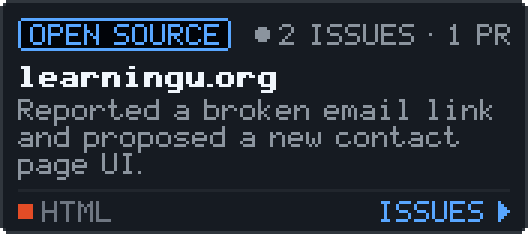</a>
  <a href="https://github.com/transmogrify-cell/predictplay">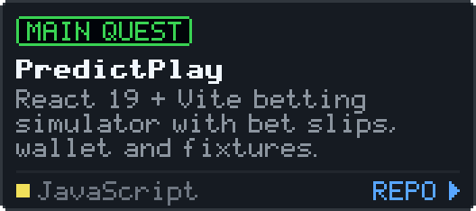</a>
  <a href="https://github.com/transmogrify-cell/SalaryPrediction">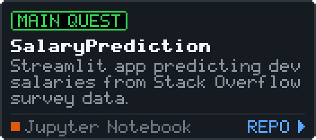</a>
  <a href="https://transmogrify-cell.github.io/portfolio/">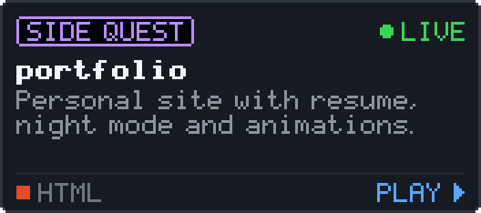</a>
  <a href="https://github.com/transmogrify-cell/EDA-ShoppingTrends-Analysis.">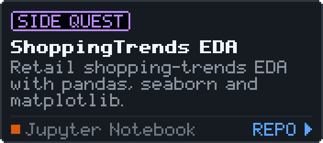</a>

  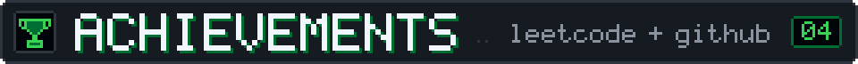 
  

  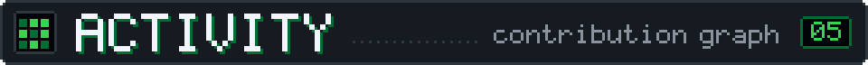 
  

  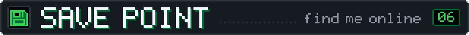 
  <a href="https://www.linkedin.com/in/himanshu-chandela-5947a6212/">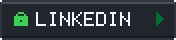</a>&nbsp;
  <a href="https://leetcode.com/u/cogentHeisnberg/">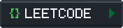</a>&nbsp;
  <a href="https://transmogrify-cell.github.io/portfolio/">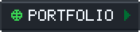</a>

   
  

